# 보카데이 (Vocaday)

**친구 둘이서 매일 같이 하는 영어 공부 웹앱.** 말해보카·스픽처럼 실제 문장의 빈칸을 타자나 말로 채우며 단어·문법을 익히고, 3줄 영어 일기를 쓰면 AI가 첨삭해 줍니다. 틀린 문제는 간격 반복으로 매일 돌아오고, 친구의 진행 상황을 서로 볼 수 있어요.

> A two-person daily English trainer: cloze-style vocab & grammar drills with typing/voice input, spaced-repetition review of mistakes, a 3-line diary with AI feedback, and a friend board. Runs on Cloudflare Workers (D1 + Workers AI), no frontend framework.

## 화면

<table>
  <tr>
    <td align="center">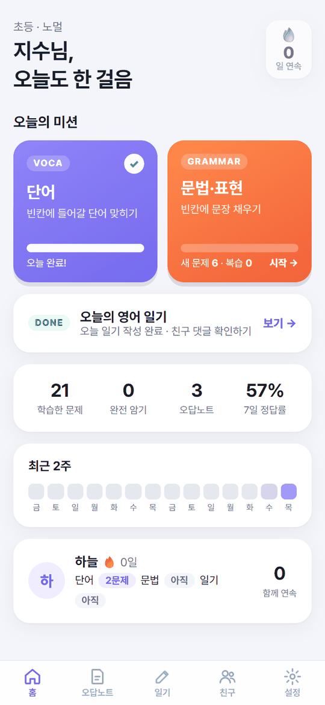<br><sub>홈 — 오늘의 미션 · 일기 · 연속 기록 · 친구 현황</sub></td>
    <td align="center">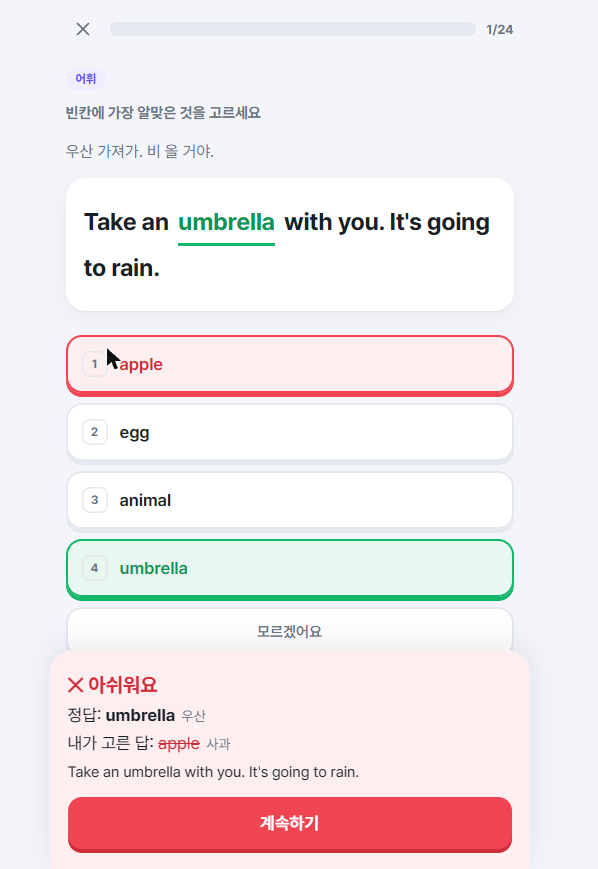<br><sub>레벨 테스트 — 고르면 바로 채점, 정답·오답의 뜻까지</sub></td>
    <td align="center">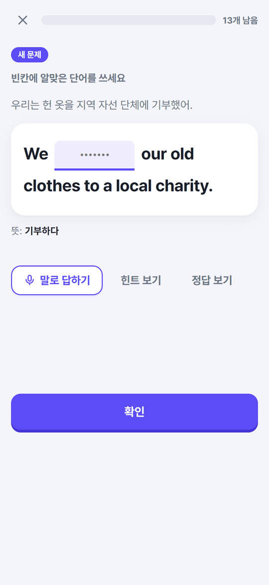<br><sub>단어 — 문장 빈칸을 타자 또는 🎤 말로</sub></td>
  </tr>
  <tr>
    <td align="center">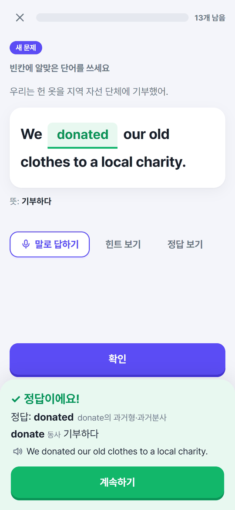<br><sub>단어 — 정답 확인, 발음 듣기</sub></td>
    <td align="center">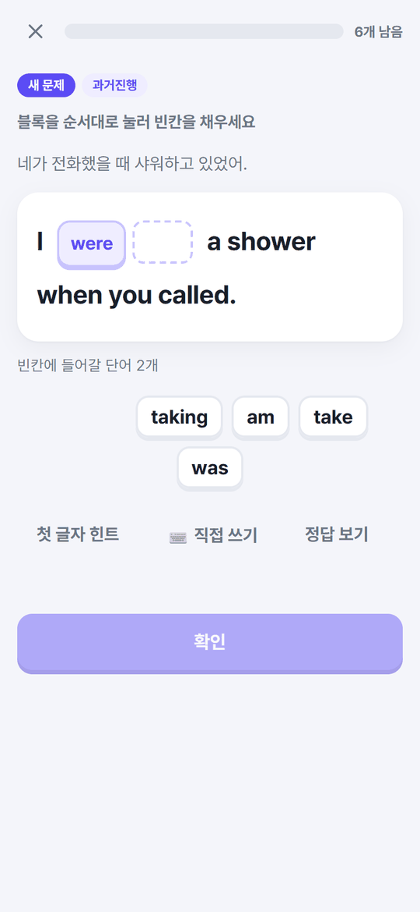<br><sub>문법·표현 — 단어 블록을 눌러 빈칸 완성</sub></td>
    <td align="center">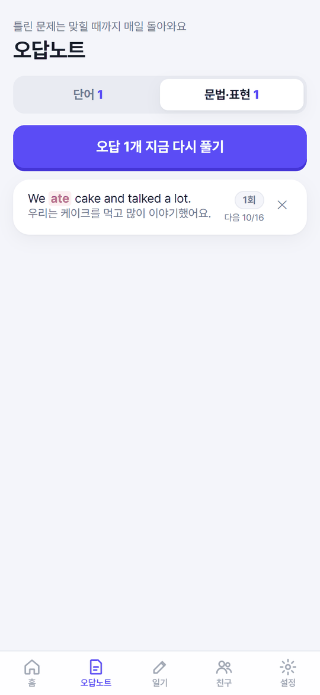<br><sub>오답노트 — 맞힐 때까지 매일 다시</sub></td>
  </tr>
  <tr>
    <td align="center">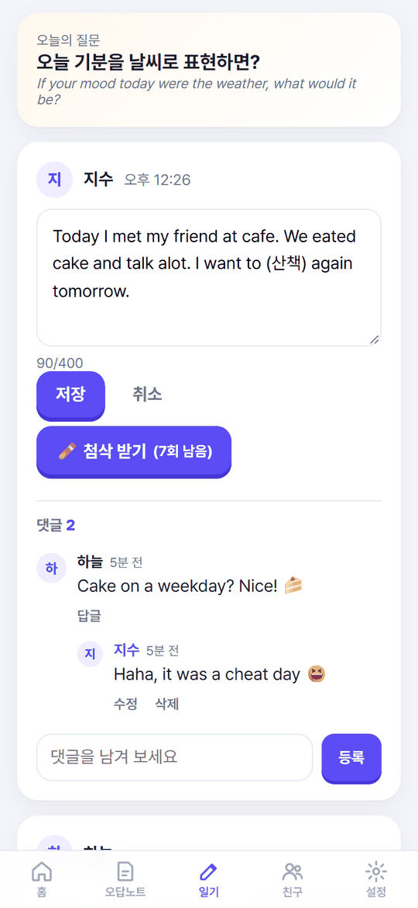<br><sub>3줄 영어 일기 — 막히는 단어는 (한국어)로</sub></td>
    <td align="center">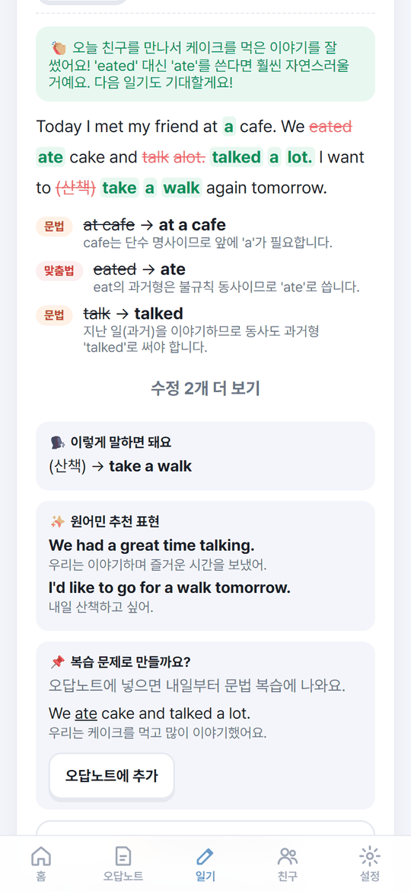<br><sub>AI 첨삭 — 칭찬 → 수정 표시 → 설명</sub></td>
    <td align="center">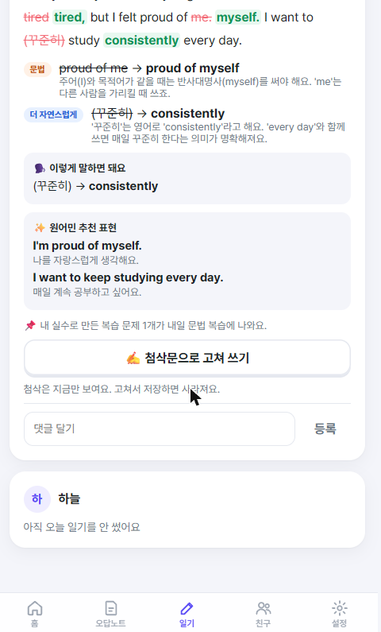<br><sub>추천 표현 · 내 실수로 만든 복습 문제</sub></td>
  </tr>
  <tr>
    <td align="center">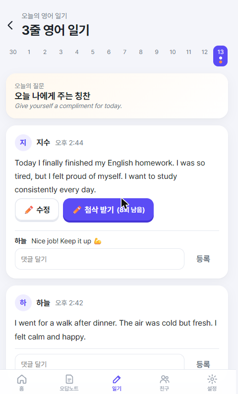<br><sub>서로의 일기에 댓글</sub></td>
    <td align="center">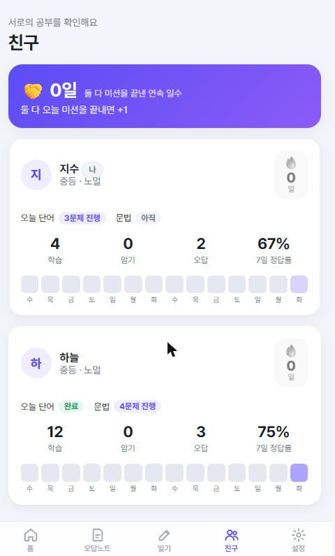<br><sub>친구 — 오늘 진행 · 정답률 · 2주 기록 · 함께 연속</sub></td>
    <td></td>
  </tr>
</table>

## 기능

**레벨 테스트**
- 풀 72문항(초등·중등·고등·실전 × 어휘·문법)에서 매번 24문제를 뽑고, 지난 회차 문제는 피합니다 — 공부한 뒤 다시 봐도 외운 답으로는 못 풀어요.
- 보기를 고르면 즉시 채점: 정답은 초록, 내가 고른 오답은 빨강, 아래에 **두 단어의 뜻**이 함께 나옵니다(뜻은 고른 뒤에만 서버가 보냅니다).
- 레벨 판정: 한 단계를 4/6 이상 맞히면 통과, 통과한 가장 높은 단계가 내 레벨. 전부 맞힌 단계는 더 배울 게 없으니 한 단계 위로.

**단어 (779개, 교육부 기본 어휘 기준 4단계)**
- 기본은 말해보카식 **문장 빈칸 채우기**: 타자로 쓰거나 🎤 말로 답합니다(단어만 말해도, 문장 전체를 말해도 됨). 복습 중간에만 4지선다가 섞입니다.
- 4지선다 보기는 단어마다 고정된 후보 6개(전부 사람이 검수)에서 뽑아, 뜻이 겹치는 보기가 절대 같이 나오지 않습니다.
- 동의어를 쓰면 바로 오답 처리하지 않고 첫 글자 힌트와 함께 한 번 더 기회를 줍니다.

**문법·표현 (340문장)**
- 교육과정 문법 + 원어민 회화 패턴. 기본은 **단어 블록 배열**(정답 블록 + 한국인 학습자가 흔히 틀리는 오답 블록), 원하면 직접 쓰기·음성.
- 하루치 문제는 문법 패턴이 번갈아 나오도록 뽑습니다(현재완료만 6개 연달아 ✗).

**복습 (간격 반복)**
- 틀린 문제는 같은 세션에서 3문제 뒤에 한 번 더, 그리고 다음 날부터 매일. 맞힐수록 1 → 2 → 4 → 7 → 15 → 30일로 간격이 늘고, 30일 상자를 통과하면 '완전 암기'.
- 복습이 밀리면 그날은 새 문제를 쉬어 갑니다. 하루 학습량은 라이트/노멀/하드.

**3줄 영어 일기**
- 매일 질문 하나. 막히면 `(꾸준히)`처럼 한국어를 섞어 써도 됩니다.
- **첨삭 받기**를 누르면 무료 맞춤법 검사기(LanguageTool)로 오류를 잡고 Cloudflare Workers AI(오픈 모델)가 한국어로 설명합니다: 칭찬 → 원문 대비 수정 표시 → 맞춤법/문법/자연스러움 분류 설명 → 괄호 속 한국어의 영어 표현 → 원어민 추천 표현.
- 첨삭은 그 자리에서만 보이고, 고쳐서 저장하면 사라집니다. 내 실수로 만든 복습 문제가 다음 날 문법 복습에 섞여 나옵니다.
- 저장한 일기는 게시글처럼 보이고, 서로 댓글·답글(한 단계)을 달고 내 댓글은 고치거나 지울 수 있습니다.
- 등록·저장·첨삭을 누르면 그 버튼만 로딩 표시가 되고 같은 영역의 다른 버튼은 끝날 때까지 잠깁니다(여러 번 눌러도 한 번만 처리). 서버도 같은 사람이 10초 안에 보낸 같은 댓글은 한 번만 저장합니다.

**친구**
- 상대의 오늘 진행, 연속 학습일, 정답률, 최근 2주 기록. 둘 다 미션을 끝낸 날이 이어지면 '함께 연속'이 올라갑니다.

## 기술

- **백엔드**: Cloudflare Workers + D1(SQLite) + Workers AI. 외부 의존성 없음.
- **프론트**: 프레임워크 없는 단일 페이지(해시 라우팅), 모바일 우선. Web Speech API(음성 입력·발음).
- **첨삭**: LanguageTool 공개 API + `@cf/qwen/qwen3.8-27b`(추론 모드 off). 모델 출력은 서버에서 스키마·규칙 검증 후에만 저장.
- **계정**: 두 사용자 고정. 아이디·표시 이름·초기 비밀번호는 코드가 아니라 비밀값 `USERS`에 둡니다.

```
src/worker.js        API · 간격반복 큐 · 레벨 테스트 · 일기
src/queue.js         새 문제 순서(내 레벨 → 위 → 아래, 패턴 번갈아)
src/distractors.js   4지선다 보기 선택 규칙
src/placement.js     레벨 판정
src/diary.js         일기 첨삭(LanguageTool + Workers AI, 결과 검증)
public/              화면 (app.js · grade.js 채점 · style.css)
content/             문항 JSON(단어 4단계 · 문법 2파일 · 레벨 테스트 · 유의어 묶음 · 고정 오답 후보 · 숨김 단어)
test/                전수 테스트 · 스모크 · 문항 패치/검수 도구
reports/, research_notes/   설계 전 리서치(교육과정 어휘, 앱 UX, 간격반복, 회화 표현)
```

## 실행

```bash
npm install
npx wrangler login
npx wrangler d1 create vocaday          # 결과의 database_id를 wrangler.jsonc에 넣기
```

계정 파일 `.dev.vars`(로컬, git에 올라가지 않음):

```
USERS={"<아이디>":{"name":"<표시 이름>","pw":"<처음 비밀번호>"},"<아이디2>":{"name":"...","pw":"..."}}
```

```bash
npm run dev          # http://localhost:8787
npm test             # 모든 문항 자동 검증
npm run smoke        # 로컬 서버 핵심 흐름(로컬 DB에만 씀)
```

배포:

```bash
npx wrangler secret put USERS   # 위와 같은 JSON
npm run deploy
```

첫 로그인 후 설정에서 비밀번호를 바꾸세요.

## 앱으로 쓰기 (홈 화면 앱 · 갤럭시 APK)

웹 사이트와 별도로 **앱용 사이트**를 두 번째 Worker(`--env app`)로 배포합니다. `app/build.mjs`가 `public/`을 그대로 복사한 뒤 매니페스트·서비스 워커·아이콘만 얹으므로(`dist-app/`), 웹 사이트 쪽 파일은 바뀌지 않습니다. 데이터(D1)와 계정(`USERS` secret)은 두 Worker가 공유합니다.

```bash
npx wrangler secret put USERS --env app
npm run deploy:app
```

- **아이폰**: Safari에서 앱 사이트를 열고 공유 → **홈 화면에 추가**. (설치 파일 배포는 Apple 정책상 개발자 계정·TestFlight 없이는 불가)
- **갤럭시/안드로이드**: Google Bubblewrap(TWA)으로 APK를 만듭니다. `android/twa-manifest.json`의 `host`를 앱 사이트 도메인으로, 서명 키 지문을 `app/.well-known/assetlinks.json`에 넣으면 주소창 없이 전체 화면으로 열립니다.

```bash
# 최초 1회: JDK 17 + Android cmdline-tools를 ~/.bubblewrap 에 두고 config.json에 경로 지정, 서명 키 생성
keytool -genkeypair -alias android -keyalg RSA -keysize 2048 -validity 10000 -keystore android/android.keystore
# 프로젝트 생성 → 빌드 → 서명
cd android && npx @bubblewrap/cli update --skipVersionUpgrade   # 최초 생성 때만(아래 주의)
./gradlew.bat assembleRelease            # app/build/outputs/apk/release/app-release-unsigned.apk
zipalign -f -p 4 <unsigned.apk> aligned.apk && apksigner sign --ks android.keystore --ks-key-alias android --out vocaday.apk aligned.apk
```

- **알림은 크롬으로 열려야 동작합니다.** 갤럭시 기본 브라우저(삼성 인터넷) 앱 모드에서는 알림을 허용해도 권한이 저장되지 않아, `LauncherActivity.createTwaLauncher()`에서 크롬을 우선 쓰도록 고쳤습니다(1.2.0, `AndroidManifest.xml`에 `<queries>` 추가). `bubblewrap update`를 다시 실행하면 이 수정이 덮어써지므로, 버전은 `app/build.gradle`의 `versionCode`/`versionName`만 올려 `gradlew`로 빌드합니다.
- 서버(화면·API) 변경은 앱에 바로 반영되고, 앱을 다시 설치해야 하는 건 브라우저 엔진·권한·이름·아이콘 같은 껍데기를 바꿀 때뿐입니다.

`android/`(서명 키 포함)는 git에 올라가지 않습니다. 서명 키와 비밀번호를 잃으면 같은 앱으로 업데이트할 수 없으니 따로 보관하세요.

## 문항 품질을 지키는 방법

- `npm test` — 단어 779 · 문법 340 · 레벨 테스트 72 · 고정 오답 후보 4,674개를 실제 채점 코드로 전부 풀어 봅니다: 정답·대체 정답·약형(I'm/I am)·음성 입력·아포스트로피 없는 입력, 빈칸 자리표시에 정답 노출, 보기 뜻 겹침, 하루치 패턴 분산, 레벨 판정 규칙.
- 모든 문항은 정답을 모르는 상태에서 푸는 **블라인드 풀이**를 거쳤고, 4지선다 후보는 하나씩 검수해 지적 0건까지 교체했습니다.
- 4지선다 보기(`content/distractors.json`): 단어마다 `{en, ko}` 후보 6개(철자가 닮은 함정 3개 이상), 정답과 같은 레벨 이상만. 쉬운 레벨 단어는 철자가 닮은 함정일 때만 허용하고, 뜻이 겹치면 테스트가 실패합니다.
- 너무 쉬운 단어는 지우지 않고 `content/hidden.json`에 넣어 숨깁니다(목록에서 빼면 다시 나옴). 내 레벨보다 쉬운 문제는 새 문제·복습·오답노트에 나오지 않습니다.
- 문항 수정: `node test/patch-items.mjs '{"<id>":{...}}'` → 뜻·유의어가 바뀌면 `content/distractors.json`의 그 단어 후보도 확인 → `npm test`.
- 블라인드 문제지 만들기: `node test/export-blind.mjs <out.txt> <content 파일...>`, 답안 채점: `node test/content.mjs <답안.json>`.

## 학습 설계 근거

`reports/` 의 리서치 요약: 2022 개정 교육과정 기본 어휘 3,000개의 단계 구분, 말해보카·스픽의 학습 흐름(빈칸 문장 + 타이핑/말하기, 3단계 채점), Leitner 간격 반복과 복습 상한, 회화 고빈도 패턴, 하루 학습량 프리셋.
